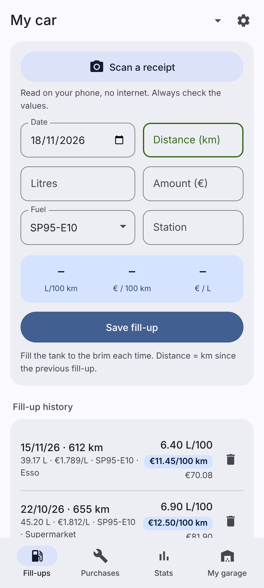
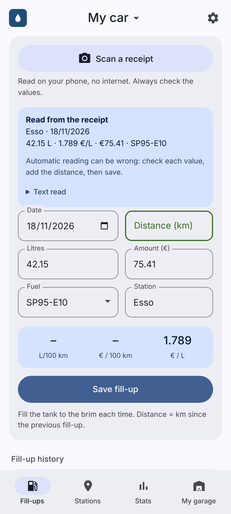
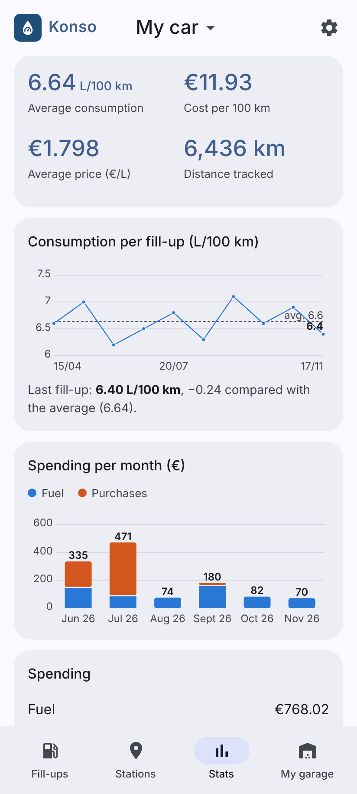
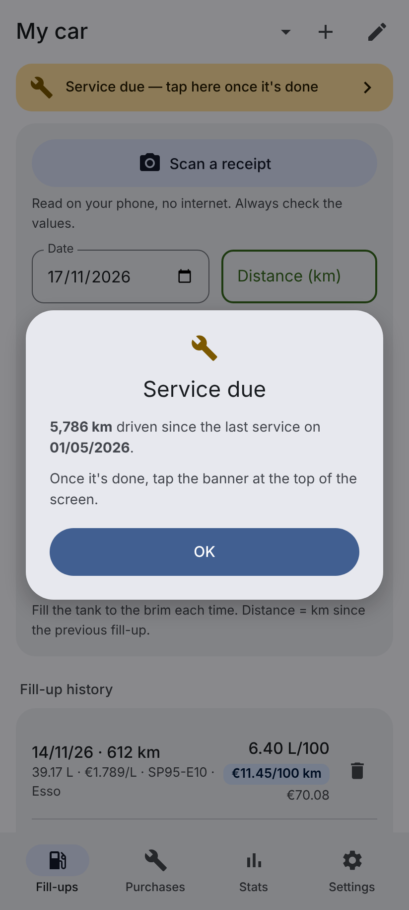
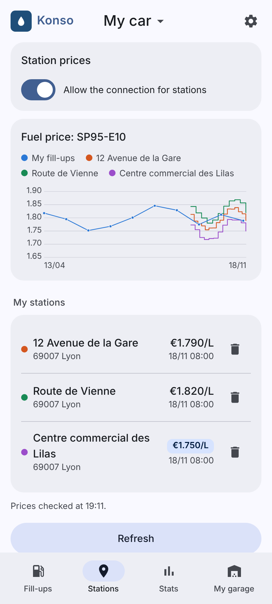
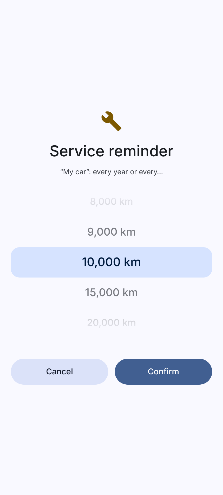
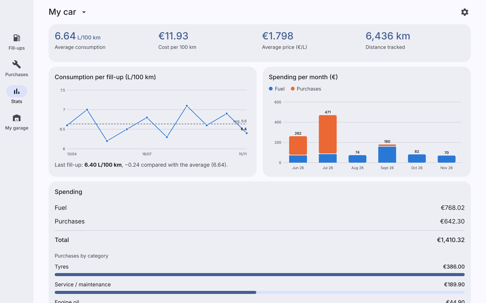

# Konso

**Fuel consumption and car maintenance tracker for Android — and for any phone, tablet or computer as a web app.**
Offline, private, open source — and proudly built with AI.


-8a2be2)

*La version française est plus bas : [Français](#konso--français).*

<table>
  <tr>
    <td align="center"><br><sub>Fill-ups</sub></td>
    <td align="center"><br><sub>Receipt scan, on the phone</sub></td>
    <td align="center"><br><sub>Overview</sub></td>
  </tr>
  <tr>
    <td align="center"><br><sub>Service reminder</sub></td>
    <td align="center"><br><sub>Station prices (optional connection)</sub></td>
    <td align="center"><br><sub>Wheel picker</sub></td>
  </tr>
  <tr>
    <td align="center" colspan="3"><br><sub>Web version on a computer: the layout adapts to the screen</sub></td>
  </tr>
</table>

## 🤖 Proudly built with AI

Konso is an app we are proud of — and it was built entirely with AI. The Android code, the interface, the translations into 10 languages, the automated tests, the build pipeline and this README were all written by **Claude** (Anthropic) through **Claude Code**. A human decided what the app should do, tested every version on a real phone and approved every change.

How it is made:

- Every feature is developed on its own branch. GitHub Actions builds a separate **"Konso Test"** app for it, which installs next to the real one.
- The feature is checked by automated browser tests and on a phone, then merged into `main` through a pull request.
- Commits are co-authored by Claude, so the history shows exactly what the AI did.

Written by an AI does not mean unchecked: all the source code is open, so anyone can read it, audit it and improve it.

## 🔒 Privacy first

- **No account, no ads, no analytics, no tracking.**
- **Works offline.** The network permission serves the app's own files on `127.0.0.1`; every request to any other host is blocked in `MainActivity`. The **one optional exception**: if you turn on the switch in the *Stations* tab, the app may reach the official French fuel price site (`data.economie.gouv.fr`) and, for the stations map, the OpenStreetMap tiles (`tile.openstreetmap.org`), and only those, to show station prices. It is off by default. The location permission is only used by the map's *Locate me* button; the position stays on the phone.
- **Receipts are read on the phone.** The OCR engine (Tesseract) is embedded; photos never leave the device.
- **Your data stays yours**: inside the app, and in a plain `konso.json` file saved to the folder you choose (on the phone, or on Google Drive through the Android file picker). You can read it, copy it or delete it at any time.
- **Web version**: the site is made of static files only, with no server code. GitHub, which hosts it, sees the requests for the app's files like for any website, never your data, which stays in your browser.
- **Open source** under the GPL-3.0 licence: nothing is hidden.

## Features

- ⛽ **Fill-ups**: distance, litres, amount → L/100 km, cost per 100 km, price per litre. The fuel of your last fill-up is preselected; the distance field is outlined in green, and any missing field turns red when you save.
- 📷 **Receipt scanning**: take a photo of a fuel receipt and the form fills itself (tuned for French receipts; always check the values). If the fuel type can't be read, the app asks you to pick it instead of guessing.
- 🔧 **Purchases** (in *My garage*): oil, parts, tyres, servicing… sorted by category.
- 🗺️ **Stations map** (France, optional connection): the stations in view with the price of your car's fuel, from green (cheapest) to red, tap one for all its prices, to follow it or for directions; *Locate me* centres the map on you.
- 📍 **Station prices** (France, optional connection): follow as many stations as you like, found by postcode, with the last official price and its date, and a chart of the fuel price of the selected car (your own fill-ups and the followed stations). Prices come from the government's live feed; the chart builds up as new prices are recorded.
- 🛠️ **Service reminders**: every year or every 10,000 km, whichever comes first (adjustable from 100 to 100,000 km, per car). A message appears once, then an amber banner stays at the top of the screen; tap it once the service is done and tracking starts again from zero.
- 📊 **Overview**: averages, consumption chart, monthly spending.
- 📏 **Units and currency**: kilometres or miles (L/100 km, UK mpg, or US mpg with US gallons) and €, £, $, CHF, zł, lei or ₺. Chosen with four wheels at first launch (language, units, currency, theme — Light proposed) and changeable in Settings. Data is always stored in km and litres, so switching units loses nothing.
- 🚗 **Several cars**, each with its own history and reminders, managed in the *My garage* tab (optional advanced options: purchase price, mileage at purchase, insurance per year or per month).
- 💶 **Buying a new car?** *My garage* compares the yearly cost of your current car (from your fill-ups) with the one you want to buy, and tells you when the change pays for itself. Updated as you type.
- 💾 **Automatic backup** to `konso.json`, updated after every change.
- 🎡 **Wheel pickers** for language, units, currency, categories and service distance.
- 🌍 **10 languages**: English, French, Spanish, German, Italian, Portuguese, Dutch, Polish, Turkish, Romanian.
- ❓ **Built-in help** ("How it works" in Settings) and a Material Design 3 interface with light and dark themes: automatic (like the device), or chosen in Settings.
- 🖥️ **Adaptive layout**: bottom bar on phones; on tablets, computers and phones in landscape, a navigation rail on the left and two columns.

## Install

1. Download `konso.apk` from the [latest release](../../releases/latest).
2. Open it on your phone and allow installing apps from unknown sources.

Requires Android 10 or later.

### Web version (iPhone, iPad, computers, any Android phone)

Konso is also a web app (PWA), published with GitHub Pages: the link is in the *About* section of this repository. Open it once, then install it:

- **iPhone / iPad**: in Safari, *Share* → *Add to Home Screen*.
- **Android, Windows, Linux, macOS**: in Chrome or Edge, the install icon in the address bar, or the menu → *Install app*.
- **Mac with Safari**: *File* → *Add to Dock*.

Once installed it has its own icon and works without internet, receipt scanning included. Data stays in the browser of each device: in Settings, *Save a backup file* keeps a copy (and moves your data to another device with *Open a backup file*). The web version shares the code of the Android app; the APK is not changed by it.

## Build

- **Android Studio**: open the folder, then *Build → Build APK(s)*.
- **Command line** (JDK 17 + Android SDK):
  ```sh
  ./gradlew assembleDebug
  ```
- **GitHub Actions**: every push to `main` builds the APK (artifact `konso-apk`). Running the workflow manually, or a commit on `main` whose message contains `[release]`, publishes the APK in the `latest` release, and once per version in a `v<versionName>` release (`konso-<version>.apk`), whose tag is used by F-Droid-style app stores.
- **Web version**: `node tools/build-web.js <folder>` builds the site (the files of `assets/www`, plus `web/`: icons, offline cache). The *Publier la version web* workflow publishes it to the `gh-pages` branch, which GitHub Pages serves (*Settings → Pages → Deploy from a branch → gh-pages*).
- **OCR engine from source**: `tools/build-tesseract.sh` rebuilds the Tesseract files of `vendor/` from the source code of [tesseract.js-core](https://github.com/naptha/tesseract.js-core) and [tesseract.js](https://github.com/naptha/tesseract.js) (Emscripten 4.0.15, Node.js). The *Tesseract from source* workflow runs it and checks the result with `tools/ocr-test.js`.
- **Map library from source**: `tools/build-leaflet.sh` rebuilds `vendor/leaflet.js` and `leaflet.css` from the source code of [Leaflet](https://github.com/Leaflet/Leaflet) 1.9.4 (Node.js: Rollup and UglifyJS, as Leaflet's own release build). The *Leaflet from source* workflow runs it and checks that the result is identical, byte for byte, to the files of the repository.

## Development

`main` only receives finished, tested work.

1. Each feature or fix is developed on its own branch: `feature/<name>` or `fix/<name>`.
2. Each push to a branch builds a **test APK**, published in the `test-<branch>` pre-release (`/` becomes `-`) as `konso-test.apk`.
3. The test APK installs **next to** the real app as **Konso Test** (`app.konso.test`) and uses its own backup file, `konso-test.json`, so real data is never touched. To test with your real data, copy `konso.json` to `konso-test.json` in the chosen folder.
4. Each push to a branch also publishes a **web test build**, "Konso Test", in `test/<branch>/` of the web version, with its own data and offline cache.
5. Once validated, the branch is merged into `main` through a pull request and deleted; its test pre-release and web test build are then deleted automatically.

Commit messages are written in English and explain what changed and why. Locally, `./gradlew assembleDebug -PkonsoTest=demo` builds the same test APK. The screenshots above are generated by `node tools/screenshots.js` (requires Playwright).

## Signing

The APK is signed with `app/debug.keystore`, a **public** test key included in the repository so that updates install over each other. Anyone can sign an APK with this key: only install APKs from a trusted source, and use your own private key if you redistribute the app.

## Project structure

```
app/src/main/
├── assets/www/
│   ├── index.html      Screens (the four tabs and the overlays)
│   ├── app.js          Behaviour, organised in commented sections (start here)
│   ├── app.css         Styles (Material Design 3, light and dark)
│   ├── i18n.js         Translations (10 languages)
│   ├── parse.js        Receipt parsing
│   └── vendor/         Tesseract.js and the French language model, Leaflet (map)
└── java/app/konso/
    └── MainActivity.java   WebView, local server, camera, backup file
web/                        Web version only (never in the APK)
├── sw.js                   Offline cache (service worker)
└── icons/                  App icons for browsers and home screens
tools/
├── build-web.js            Builds the web version (app + web/ + manifest)
├── web-icons.js            Regenerates web/icons from the Android launcher icon
├── screenshots.js          Regenerates the screenshots (README and store listing)
├── build-tesseract.sh      Rebuilds the OCR engine from source
├── build-leaflet.sh        Rebuilds the map library (Leaflet) from source
└── ocr-test.js             Checks that an OCR engine build reads text
fastlane/metadata/android/  Store listing (F-Droid, IzzyOnDroid), 10 languages
```

## Licence

Konso is free software under the **GNU GPL v3.0** — see [`LICENSE`](LICENSE).

Third-party components: [Tesseract.js](https://github.com/naptha/tesseract.js) and its language data, under the Apache 2.0 licence, and [Leaflet](https://leafletjs.com) 1.9.4, under the BSD 2-Clause licence (see `app/src/main/assets/www/vendor/`). Map data © [OpenStreetMap](https://www.openstreetmap.org/copyright) contributors.

---

# Konso — Français

**Suivi de consommation de carburant et d'entretien de voiture, pour Android — et pour tout téléphone, tablette ou ordinateur en version web.**
Hors ligne, respectueuse de la vie privée, open source — et fièrement créée avec l'IA.

Les captures d'écran ci-dessus montrent l'appli en anglais ; elle est aussi disponible en français et dans 8 autres langues.

## 🤖 Fièrement créée avec l'IA

Konso est une appli dont nous sommes fiers, et elle a été entièrement réalisée avec l'IA. Le code Android, l'interface, les traductions en 10 langues, les tests automatiques, la chaîne de compilation et ce README ont été écrits par **Claude** (Anthropic), avec **Claude Code**. Un humain a décidé de ce que l'appli devait faire, a testé chaque version sur un vrai téléphone et a validé chaque modification.

Comment elle est faite :

- Chaque fonctionnalité est développée sur sa propre branche. GitHub Actions compile pour elle une appli séparée, **« Konso Test »**, qui s'installe à côté de la vraie.
- La fonctionnalité est vérifiée par des tests automatiques dans un navigateur et sur téléphone, puis fusionnée dans `main` par pull request.
- Les commits sont co-signés par Claude : l'historique montre exactement ce que l'IA a fait.

Écrite par une IA ne veut pas dire non vérifiée : tout le code est ouvert, chacun peut le lire, l'auditer et l'améliorer.

## 🔒 La vie privée d'abord

- **Aucun compte, aucune publicité, aucune statistique, aucun pistage.**
- **Fonctionne hors ligne.** La permission réseau sert à afficher les fichiers de l'appli sur `127.0.0.1` ; toute requête vers un autre hôte est bloquée dans `MainActivity`. **Seule exception, facultative** : si vous activez l'interrupteur de l'onglet *Stations*, l'appli peut joindre le site officiel des prix des carburants (`data.economie.gouv.fr`) et, pour la carte des stations, les images de carte d'OpenStreetMap (`tile.openstreetmap.org`), et uniquement eux, pour afficher les prix des stations. Il est désactivé par défaut. La permission de localisation ne sert qu'au bouton *Me localiser* de la carte ; la position reste sur le téléphone.
- **Les tickets sont lus sur le téléphone.** Le moteur de lecture (Tesseract) est embarqué ; les photos ne quittent jamais l'appareil.
- **Vos données restent à vous** : dans l'appli, et dans un simple fichier `konso.json` enregistré dans le dossier de votre choix (téléphone, ou Google Drive via le sélecteur de fichiers Android). Vous pouvez le lire, le copier ou le supprimer à tout moment.
- **Version web** : le site n'est fait que de fichiers statiques, sans code côté serveur. GitHub, qui l'héberge, voit les demandes des fichiers de l'appli comme pour n'importe quel site, jamais vos données, qui restent dans votre navigateur.
- **Open source**, sous licence GPL-3.0 : rien n'est caché.

## Fonctionnalités

- ⛽ **Pleins** : distance, litres, montant → L/100 km, coût aux 100 km, prix au litre. Le carburant du dernier plein est présélectionné ; le champ distance est entouré en vert, et un champ oublié passe en rouge à l'enregistrement.
- 📷 **Lecture de ticket** : une photo du ticket remplit le formulaire (prévue pour les tickets français ; valeurs toujours à vérifier). Si le carburant n'est pas lisible, l'appli demande de le choisir au lieu de deviner.
- 🔧 **Achats** (dans *Mon garage*) : huile, pièces, pneus, entretien… classés par catégorie.
- 🗺️ **Carte des stations** (France, connexion facultative) : les stations de la zone affichée avec le prix du carburant de votre voiture, du vert (la moins chère) au rouge ; touchez-en une pour voir tous ses prix, la suivre ou lancer l'itinéraire ; *Me localiser* centre la carte sur vous.
- 📍 **Prix des stations** (France, connexion facultative) : suivez autant de stations que vous voulez, trouvées par code postal, avec le dernier prix officiel et sa date, et un graphique du prix du carburant de la voiture choisie (vos pleins et les stations suivies). Les prix viennent du flux en direct du gouvernement ; la courbe se construit au fil des prix relevés.
- 🛠️ **Rappels d'entretien** : tous les ans ou tous les 10 000 km, au premier des deux (réglable de 100 à 100 000 km, par voiture). Un message s'affiche une fois, puis un bandeau ambre reste en haut de l'écran ; un appui valide l'entretien et le suivi repart de zéro.
- 📊 **Bilan** : moyennes, courbe de consommation, dépenses par mois.
- 📏 **Unités et monnaie** : kilomètres ou miles (L/100 km, mpg britannique, ou mpg américain avec gallons US) et €, £, $, CHF, zł, lei ou ₺. Choisis avec quatre roues au premier lancement (langue, unités, monnaie, thème — Clair proposé), modifiables dans les Réglages. Les données sont toujours enregistrées en km et en litres : changer d'unité ne perd rien.
- 🚗 **Plusieurs voitures**, chacune avec son historique et ses rappels, gérées dans l'onglet *Mon garage* (options avancées facultatives : prix d'achat, kilométrage à l'achat, assurance par an ou par mois).
- 💶 **Envie d'une nouvelle voiture ?** *Mon garage* compare le coût annuel de ta voiture actuelle (d'après tes pleins) avec celle que tu veux acheter, et te dit quand le changement est rentabilisé. Calculé pendant que tu tapes.
- 💾 **Sauvegarde automatique** dans `konso.json`, mise à jour à chaque modification.
- 🎡 **Choix par roue** pour la langue, les unités, la monnaie, les catégories et le kilométrage d'entretien.
- 🌍 **10 langues** : français, anglais, espagnol, allemand, italien, portugais, néerlandais, polonais, turc, roumain.
- ❓ **Aide intégrée** (« Comment ça marche ? » dans les Réglages) et interface Material Design 3, en thème clair ou sombre : automatique (comme l'appareil) ou choisi dans les Réglages.
- 🖥️ **Mise en page adaptative** : barre en bas sur téléphone ; sur tablette, ordinateur et téléphone à l'horizontale, un rail de navigation à gauche et deux colonnes.

## Installer

1. Téléchargez `konso.apk` depuis la [dernière version](../../releases/latest).
2. Ouvrez-le sur votre téléphone et autorisez l'installation d'applications de source inconnue.

Android 10 ou plus récent.

### Version web (iPhone, iPad, ordinateurs, tout téléphone Android)

Konso est aussi une appli web (PWA), publiée avec GitHub Pages : le lien est dans la section *About* de ce dépôt. Ouvrez-la une fois, puis installez-la :

- **iPhone / iPad** : dans Safari, *Partager* → *Sur l'écran d'accueil*.
- **Android, Windows, Linux, macOS** : dans Chrome ou Edge, l'icône d'installation de la barre d'adresse, ou le menu → *Installer l'application*.
- **Mac avec Safari** : *Fichier* → *Ajouter au Dock*.

Une fois installée, elle a sa propre icône et fonctionne sans internet, lecture de ticket comprise. Les données restent dans le navigateur de chaque appareil : dans les Réglages, *Enregistrer un fichier de sauvegarde* en garde une copie (et permet de passer à un autre appareil avec *Ouvrir un fichier de sauvegarde*). La version web partage le code de l'appli Android ; elle ne change rien à l'APK.

## Compiler

- **Android Studio** : ouvrir le dossier, puis *Build → Build APK(s)*.
- **Ligne de commande** (JDK 17 + SDK Android) : `./gradlew assembleDebug`
- **GitHub Actions** : chaque push sur `main` compile l'APK (artefact `konso-apk`). Un lancement manuel du workflow, ou un commit sur `main` dont le message contient `[release]`, publie l'APK dans la release `latest`, et une fois par version dans une release `v<versionName>` (`konso-<version>.apk`) dont le tag sert aux magasins d'applis de type F-Droid.
- **Version web** : `node tools/build-web.js <dossier>` construit le site (les fichiers de `assets/www`, plus `web/` : icônes, cache hors ligne). Le workflow *Publier la version web* le publie dans la branche `gh-pages`, servie par GitHub Pages (*Settings → Pages → Deploy from a branch → gh-pages*).
- **Moteur OCR depuis les sources** : `tools/build-tesseract.sh` recompile les fichiers Tesseract de `vendor/` depuis le code source de [tesseract.js-core](https://github.com/naptha/tesseract.js-core) et [tesseract.js](https://github.com/naptha/tesseract.js) (Emscripten 4.0.15, Node.js). Le workflow *Tesseract depuis les sources* le lance et vérifie le résultat avec `tools/ocr-test.js`.
- **Bibliothèque de carte depuis les sources** : `tools/build-leaflet.sh` recompile `vendor/leaflet.js` et `leaflet.css` depuis le code source de [Leaflet](https://github.com/Leaflet/Leaflet) 1.9.4 (Node.js : Rollup et UglifyJS, comme la compilation officielle de Leaflet). Le workflow *Leaflet from source* le lance et vérifie que le résultat est identique, octet pour octet, aux fichiers du dépôt.

## Développement

`main` ne reçoit que des fonctionnalités terminées et testées.

1. Chaque fonctionnalité ou correction se fait sur sa propre branche : `feature/<nom>` ou `fix/<nom>`.
2. Chaque push sur la branche compile un **APK de test**, publié dans la pré-release `test-<branche>` (les `/` deviennent des `-`), fichier `konso-test.apk`.
3. L'APK de test s'installe **à côté** de la vraie appli, sous le nom **Konso Test** (`app.konso.test`), avec son propre fichier `konso-test.json` : les vraies données ne sont jamais touchées. Pour tester avec ses vraies données, copier `konso.json` en `konso-test.json` dans le dossier choisi.
4. Chaque push sur une branche publie aussi une **version web de test**, « Konso Test », dans `test/<branche>/` de la version web, avec ses propres données et son propre cache hors ligne.
5. Une fois validée, la branche est fusionnée dans `main` par pull request puis supprimée ; sa pré-release de test et sa version web de test sont alors supprimées automatiquement.

Les messages de commit sont rédigés en anglais et expliquent ce qui a changé et pourquoi. Les captures d'écran sont générées par `node tools/screenshots.js` (nécessite Playwright).

## Signature

L'APK est signé avec `app/debug.keystore`, une clé de test **publique** incluse dans le dépôt pour que les mises à jour s'installent par-dessus la version précédente. N'importe qui peut signer un APK avec cette clé : n'installez que des APK provenant d'une source de confiance, et utilisez votre propre clé secrète si vous redistribuez l'appli.

## Licence

Konso est un logiciel libre sous licence **GNU GPL v3.0** — voir [`LICENSE`](LICENSE).

Composants tiers : [Tesseract.js](https://github.com/naptha/tesseract.js) et ses données de langue, sous licence Apache 2.0, et [Leaflet](https://leafletjs.com) 1.9.4, sous licence BSD 2-Clause (voir `app/src/main/assets/www/vendor/`). Données de carte © les contributeurs d'[OpenStreetMap](https://www.openstreetmap.org/copyright).
